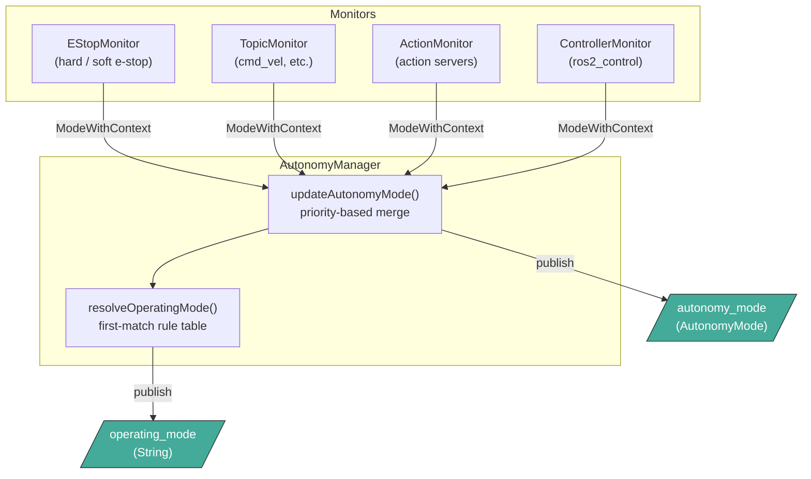
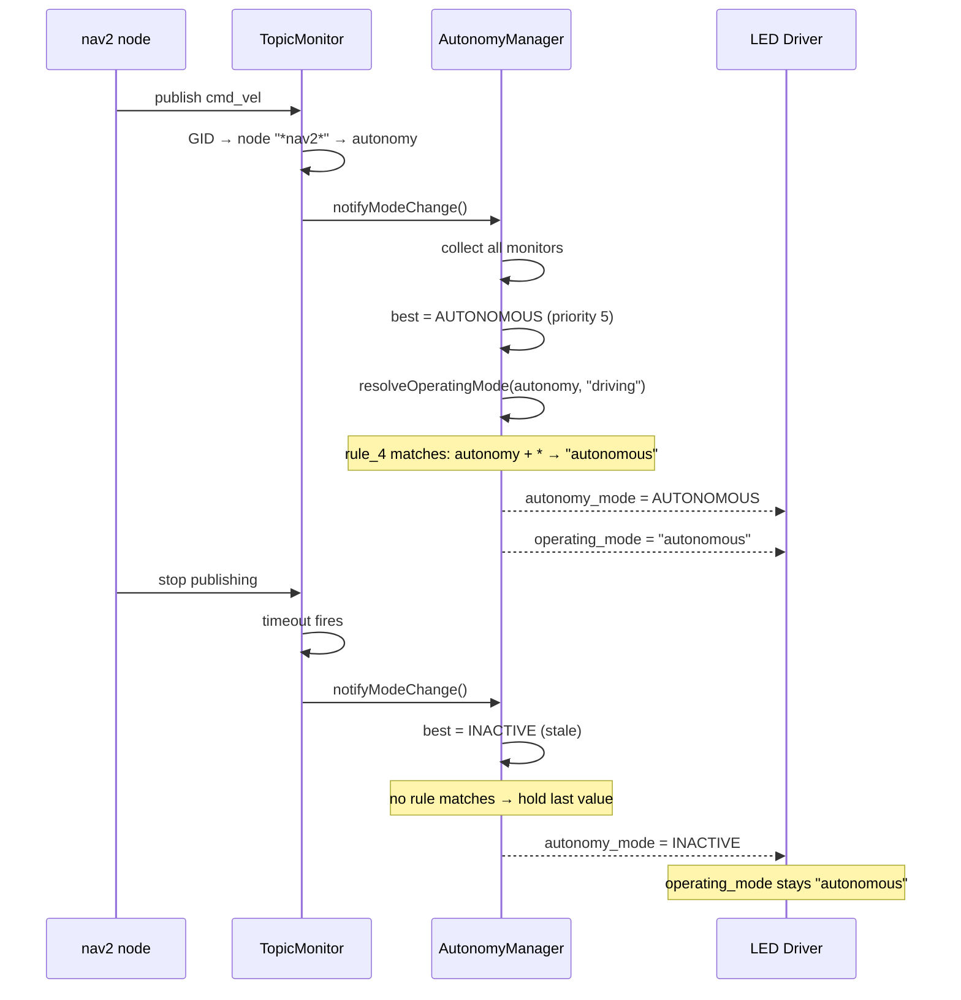

# Autonomy Manager

The Autonomy Manager is a ROS 2 composable node that determines the robot's current autonomy
mode by fusing signals from multiple independent monitors. It publishes two latched topics:

- **`autonomy_mode`** (`autonomy_manager_msgs/msg/AutonomyMode`) — the current autonomy level
- **`operating_mode`** (`std_msgs/msg/String`) — a high-level operating mode string for
  downstream consumers (e.g. LED status driver)

Both topics use `transient_local` QoS so late-joining subscribers receive the last published value.

## Architecture



Each monitor independently evaluates its inputs and reports a `ModeWithContext` containing:
- An `AutonomyMode` (autonomy level)
- An `operating_mode` label (e.g. `"driving"`, `"manipulation"`)
- A `source` string for log diagnostics (e.g. `"TopicMonitor: cmd_vel"`)

The manager picks the **highest-priority** mode across all monitors and publishes it. The
operating mode is resolved through a configurable rule table.

## Autonomy Modes

Modes are ordered by priority (highest first). When multiple monitors report different modes,
the highest-priority mode wins.

| Priority | Mode | Value | String |
|----------|------|-------|--------|
| 0 (highest) | `EMERGENCY_STOP_HARD` | 5 | `emergency_stop_hard` |
| 1 | `EMERGENCY_STOP_SOFT` | 6 | `emergency_stop_soft` |
| 2 | `UNKNOWN` | 0 | `unknown` |
| 3 | `TELEOPERATED` | 1 | `teleop` |
| 4 | `SEMI_AUTONOMOUS` | 2 | `semi_autonomy` |
| 5 | `AUTONOMOUS` | 3 | `autonomy` |
| 6 (lowest) | `INACTIVE` | 4 | `inactive` |

When no monitor reports activity, the manager falls back to the configured `stale_mode`
(default: `inactive`).

## Monitor Types

### E-Stop Monitor


Subscribes to hard and soft e-stop topics (`std_msgs/Bool`). When an e-stop is active, it
overrides all other autonomy modes due to having the highest priority. Hard e-stop takes
precedence over soft e-stop.

**Parameters** (read-only):
| Parameter | Type | Description |
|-----------|------|-------------|
| `hard_e_stop_topic` | string | Topic for hardware e-stop (empty = disabled) |
| `soft_e_stop_topic` | string | Topic for software e-stop (empty = disabled) |

### Topic Monitor


Subscribes to command topics using a **generic subscription** (no compile-time type dependency).
The topic message type is auto-discovered at runtime via `get_topic_names_and_types()`. If the
topic is not yet advertised, discovery retries every 5 seconds.

For each received message, the monitor identifies the publishing node via `publisher_gid` from
`rclcpp::MessageInfo` and maps it to an autonomy type using a three-tier resolution:

1. **Exact match** — node name matches a configured name exactly
2. **Wildcard pattern** — node name matches a glob pattern (`*`, `?`, `[...]`), first match wins
3. **Default** — configured `default_autonomy_type` fallback
4. If none match → `UNKNOWN`

**Parameters**:
| Parameter | Type | Reconfigurable | Description |
|-----------|------|:-:|-------------|
| `observed_topics` | string[] | no | List of topic names to monitor |
| `<topic>.nodes` | string[] | yes | Node names or glob patterns |
| `<topic>.autonomy_types` | string[] | yes | Autonomy type per node (same order as `nodes`) |
| `<topic>.default_autonomy_type` | string | yes | Fallback for unmatched nodes |
| `<topic>.timeout` | int | yes | Stale timeout in seconds (0 = disabled) |
| `<topic>.operating_mode` | string | no | Operating mode label (e.g. `"driving"`) |

### Action Monitor

Monitors action servers via two subscriptions per action:

- **Status topic** (`<action>/_action/status`): Typed subscription to `GoalStatusArray`. If any
  goal has `STATUS_EXECUTING` or `STATUS_ACCEPTED`, the action's autonomy type is applied. When
  all goals reach a terminal state (succeeded, aborted, canceled), the mode immediately reverts
  to `INACTIVE`. Supports multiple goals in parallel.

- **Feedback topic** (`<action>/_action/feedback`): Generic subscription (type discovered at
  runtime). Each feedback message resets a configurable timeout timer. The timeout acts as a
  **crash safety net**: if no feedback arrives while a goal is executing, the monitor assumes the
  action server has crashed and reverts to `stale_mode`. Set `timeout: 0` to disable.

**Parameters**:
| Parameter | Type | Reconfigurable | Description |
|-----------|------|:-:|-------------|
| `observed_actions` | string[] | no | List of action names to monitor |
| `<action>.autonomy_type` | string | no | Autonomy type when action is executing |
| `<action>.timeout` | int | yes | Feedback crash safety net in seconds |
| `<action>.operating_mode` | string | no | Operating mode label |

### Controller Monitor


Monitors ros2_control controllers by subscribing to the controller manager activity topic and
joint states. A controller is considered **commanding** when:

1. It is in the `ACTIVE` lifecycle state (from the activity topic), **and**
2. (If `require_motion` is true) at least one of its claimed joints has velocity above
   `joint_velocity_threshold`

**Joint discovery** is automatic: when a controller becomes active for the first time, the
monitor calls the `ListControllers` service to retrieve `claimed_interfaces` and extracts joint
names. This supports both direct interfaces (`joint1/position`) and chained controllers
(`chained_ctrl/joint1/position`).

**Parameters**:
| Parameter | Type | Reconfigurable | Description |
|-----------|------|:-:|-------------|
| `controller_manager_activity_topic` | string | no | Activity topic |
| `joint_states_topic` | string | no | Joint states topic |
| `list_controllers_service` | string | no | Service for joint discovery (auto-derived from activity topic) |
| `joint_velocity_threshold` | double | yes | Motion detection threshold in rad/s (range: 0.001–1.0) |
| `observed_controllers` | string[] | no | Controller names to monitor |
| `<controller>.autonomy_type` | string | no | Autonomy type when commanding |
| `<controller>.require_motion` | bool | yes | Whether joint motion is required |
| `<controller>.operating_mode` | string | no | Operating mode label |

## Operating Mode Rule Table

The operating mode is resolved by a **first-match rule table** that maps the combination of
`(autonomy_level, operating_mode_label)` to an output string. Rules are evaluated in order;
`"*"` acts as a wildcard matching any value.

**Hold-last-value behavior**: If no rule matches the current context (e.g. when transitioning
back to `inactive`), no operating mode is published. Because the topic uses `transient_local`
QoS, downstream subscribers continue to see the last published value. This prevents flickering
between modes during transient states.

### Rule Configuration

Rules are declared as indexed parameters (`rule_0`, `rule_1`, ...):

```yaml
operating_mode_rules:
  rule_0:
    autonomy: "emergency_stop_hard"
    mode: "*"
    output: "safe"
  rule_1:
    autonomy: "emergency_stop_soft"
    mode: "*"
    output: "safe"
  rule_2:
    autonomy: "teleop"
    mode: "driving"
    output: "driving"
  rule_3:
    autonomy: "teleop"
    mode: "manipulation"
    output: "manipulation"
  rule_4:
    autonomy: "autonomy"
    mode: "*"
    output: "autonomous"
```

The loader iterates `rule_0`, `rule_1`, ... and stops at the first missing index.

## Data Flow Example



## Full Configuration Example

```yaml
/**:
  ros__parameters:
    stale_mode: "inactive"

    # --- E-Stop ---
    hard_e_stop_topic: "/emergency_stop_hardware"
    soft_e_stop_topic: "/emergency_stop_software"

    # --- Topic monitoring ---
    observed_topics: ["cmd_vel"]

    cmd_vel:
      nodes: ["*nav2*"]
      autonomy_types: ["autonomy"]
      default_autonomy_type: "teleop"
      timeout: 3
      operating_mode: "driving"

    # --- Action monitoring ---
    observed_actions: ["move_action"]

    move_action:
      autonomy_type: "autonomy"
      timeout: 300
      operating_mode: "autonomous"

    # --- Controller monitoring ---
    controller_manager_activity_topic: "controller_manager/activity"
    joint_states_topic: "joint_states"
    joint_velocity_threshold: 0.01

    observed_controllers: ["moveit_twist_controller", "flipper_velocity_controller"]

    moveit_twist_controller:
      autonomy_type: "teleop"
      require_motion: true
      operating_mode: "manipulation"
    flipper_velocity_controller:
      autonomy_type: "autonomy"
      require_motion: true
      operating_mode: "driving"

    # --- Operating mode rules (first match wins) ---
    operating_mode_rules:
      rule_0:
        autonomy: "emergency_stop_hard"
        mode: "*"
        output: "safe"
      rule_1:
        autonomy: "emergency_stop_soft"
        mode: "*"
        output: "safe"
      rule_2:
        autonomy: "teleop"
        mode: "driving"
        output: "driving"
      rule_3:
        autonomy: "teleop"
        mode: "manipulation"
        output: "manipulation"
      rule_4:
        autonomy: "autonomy"
        mode: "*"
        output: "autonomous"
```

## Launch

```bash
ros2 launch autonomy_manager autonomy_manager.launch.yaml
```

The launch file loads the default config from `config/autonomy_manager.yaml`. All parameters
can be overridden via launch argument remapping or a custom config file.

## Dynamic Reconfiguration

Several parameters can be changed at runtime without restarting the node:

```bash
# Change topic timeout
ros2 param set /autonomy_manager cmd_vel.timeout 10

# Update node matching rules (nodes and autonomy_types must have the same length)
ros2 param set /autonomy_manager cmd_vel.nodes '["teleop_node", "*nav2*"]'
ros2 param set /autonomy_manager cmd_vel.autonomy_types '["teleop", "autonomy"]'

# Change controller motion requirement
ros2 param set /autonomy_manager arm_controller.require_motion false

# Adjust joint velocity threshold
ros2 param set /autonomy_manager joint_velocity_threshold 0.05
```

## Testing

The package includes unit tests (per-monitor using rtest) and integration tests (full node with ROS
communications):

```bash
hector test autonomy_manager
```

Test suites:
| Test File | Coverage |
|-----------|----------|
| `test_types.cpp` | Type conversions, priority ordering, glob matching |
| `test_estop_monitor.cpp` | E-stop activation, hard overrides soft |
| `test_topic_monitor.cpp` | Node matching, wildcards, defaults, timeouts, stale handling |
| `test_action_monitor.cpp` | Goal status tracking, timeout, multi-goal, feedback |
| `test_controller_monitor.cpp` | Activity state, joint motion, require_motion toggle |
| `test_autonomy_manager.cpp` | Priority merging, multi-monitor interaction |
| `test_dynamic_reconfiguration.cpp` | Runtime parameter changes, combined scenarios |

## Limitations

**Simultaneous publishers** — If nodes with different autonomy types publish to the same topic
concurrently, the mode will change with each received message.

**RMW compatibility** — The topic monitor relies on `publisher_gid` from `MessageInfo`. This
works with `rmw_fastrtps_cpp` and `rmw_zenoh_cpp`, but has a
[known issue with rmw_cyclonedds](https://github.com/ros2/rmw_cyclonedds/issues/377).

**Feedback topic discovery** — The action monitor discovers the feedback topic type at runtime.
If the action server is not yet running, it retries every 5 seconds until the topic appears.

**Controller joint discovery** — Joints are discovered via the `ListControllers` service when a
controller first becomes active. If the service is unavailable, joints remain empty and the
controller will not be considered commanding (when `require_motion` is true). Joints are
re-queried on the next activation.
